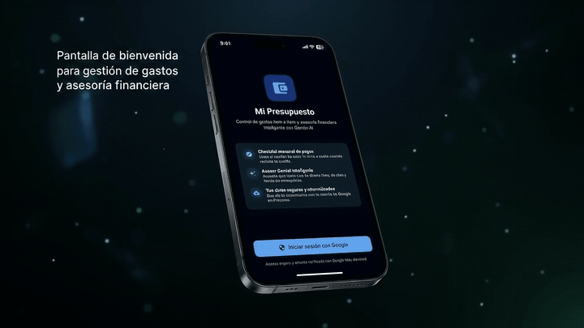
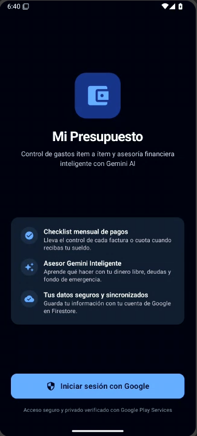
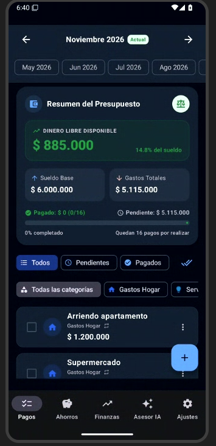
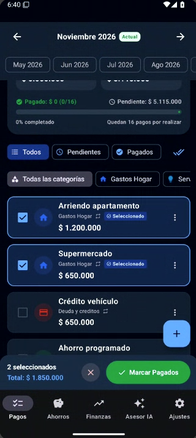
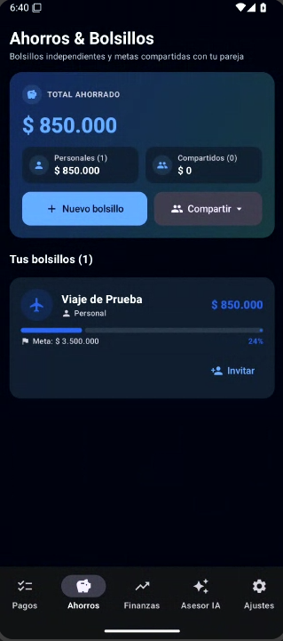
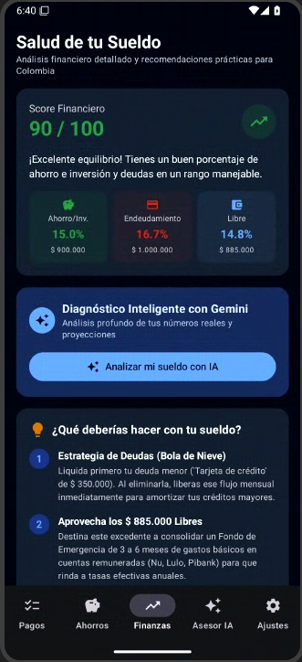
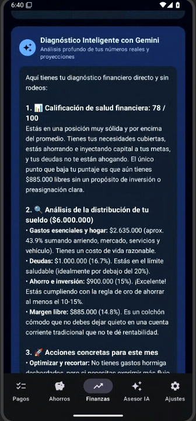
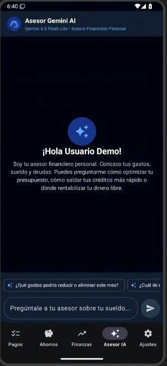
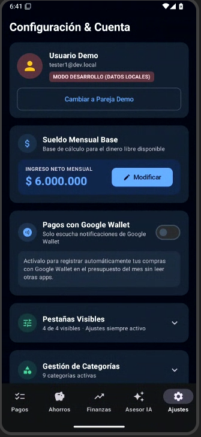
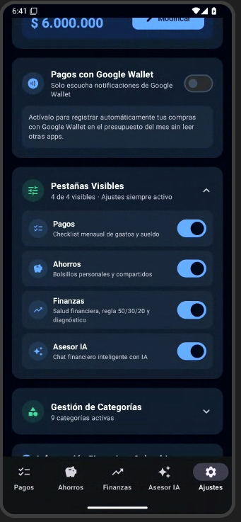

# Mi Presupuesto

> **Proyecto exploratorio desarrollado con Google AI Studio.**  
> Aplicación Android para gestionar el presupuesto mensual ítem a ítem en pesos colombianos (COP), automatizar gastos pagados con Google Wallet, ahorrar en pareja mediante bolsillos compartidos y recibir asesoría financiera personalizada con Gemini AI.

<p align="center">
  <a href="docs/media/mi_presupuesto_demo.mp4">
    
  </a>
  <br />
  <sub><strong>Vista previa animada</strong> · <a href="docs/media/mi_presupuesto_demo.mp4">Ver / descargar video completo en 1080p con audio (MP4)</a></sub>
</p>

---

## La historia detrás de la app

**Mi Presupuesto** nació como un proyecto exploratorio construido con **Google AI Studio** a partir de una necesidad muy cotidiana: cada vez que llega el sueldo mensual, saber con claridad cuánto ya está comprometido en pagos fijos (arriendo, créditos, servicios, ahorro programado) y cuánto **dinero libre real** queda disponible sin perder horas llenando hojas de cálculo.

A medida que se fue probando en uso real, el proyecto evolucionó iterativamente resolviendo problemas concretos de experiencia, automatización y seguridad:

1. **Del Excel al checklist mensual:** Se diseñó una vista centrada en el mes actual (con navegación a meses pasados y futuros) donde cada compromiso se marca como pagado de forma individual o en lote, protegiendo al usuario con confirmación antes de revertir un pago ya marcado.
2. **Menos fricción al gastar en la calle:** Para evitar olvidar compras pequeñas del día a día, se añadió un lector opcional de notificaciones que escucha **exclusivamente** a **Google Wallet**, extrae comercio y valor, y los registra automáticamente en el presupuesto del mes.
3. **Ahorrar acompañado:** Muchas metas (un viaje, un fondo de emergencia, una compra grande) se construyen en pareja o familia; por eso surgieron los **Bolsillos Compartidos**, activables con códigos temporales de invitación y sincronizados en tiempo real.
4. **Asesoría financiera con datos reales (no genérica):** En lugar de consejos abstractos, se conectó **Gemini AI** con el detalle real de ingresos, gastos y deudas del usuario para responder preguntas concretas (*"¿qué gastos puedo recortar este mes?"* o *"¿qué deuda liquido primero?"*) bajo el contexto financiero colombiano.

---

## Capturas de pantalla

> Todas las capturas utilizan **datos ficticios de demostración** (`Usuario Demo`).

<table>
  <tr>
    <td align="center" width="33%">
      <br />
      <strong>1. Bienvenida y Acceso</strong><br />
      <sub>Inicio de sesión limpio con Google Sign-In y presentación de beneficios principales.</sub>
    </td>
    <td align="center" width="33%">
      <br />
      <strong>2. Resumen del Presupuesto</strong><br />
      <sub>Sueldo base, dinero libre disponible, barra de progreso mensual y filtros por estado y categoría.</sub>
    </td>
    <td align="center" width="33%">
      <br />
      <strong>3. Pagos en Lote</strong><br />
      <sub>Selección múltiple de gastos pendientes con cálculo inmediato del total antes de marcar pagados.</sub>
    </td>
  </tr>
  <tr>
    <td align="center" width="33%">
      <br />
      <strong>4. Ahorros & Bolsillos</strong><br />
      <sub>Metas personales y compartidas con avance porcentual e invitación por código temporal.</sub>
    </td>
    <td align="center" width="33%">
      <br />
      <strong>5. Salud de tu Sueldo</strong><br />
      <sub>Score financiero, distribución ahorro/deuda/libre y recomendaciones prácticas para Colombia.</sub>
    </td>
    <td align="center" width="33%">
      <br />
      <strong>6. Diagnóstico con Gemini</strong><br />
      <sub>Análisis completo generado por IA sobre los números reales del mes y acciones concretas.</sub>
    </td>
  </tr>
  <tr>
    <td align="center" width="33%">
      <br />
      <strong>7. Asesor Gemini AI</strong><br />
      <sub>Chat conversacional con Gemini 3.5 Flash-Lite, preguntas sugeridas y contexto real en COP.</sub>
    </td>
    <td align="center" width="33%">
      <br />
      <strong>8. Ajustes y Google Wallet</strong><br />
      <sub>Edición de sueldo base e interruptor exclusivo para registrar compras desde Google Wallet.</sub>
    </td>
    <td align="center" width="33%">
      <br />
      <strong>9. Pestañas y Categorías</strong><br />
      <sub>Configuración de pestañas visibles en la barra inferior y gestión completa de categorías.</sub>
    </td>
  </tr>
</table>

---

## Funcionalidades principales

### 1. Checklist mensual de pagos (`Pagos`)
* **Navegación por meses:** Ventana de 13 meses (6 meses atrás, mes actual y 6 meses adelante) conservando el estado de cada gasto en la nube.
* **Gastos recurrentes y puntuales:** Plantilla automática para gastos fijos mensuales e ítems puntuales por mes.
* **Control rápido y seguro:** Filtros por estado (**Todos**, **Pendientes**, **Pagados**) y por categoría, selección múltiple para pagar varios ítems a la vez viendo el total acumulado, y diálogo de confirmación si se intenta devolver un ítem pagado a pendiente.

### 2. Registro automático con Google Wallet (Opcional)
* **Privacidad por diseño:** El `NotificationListenerService` filtra **exclusivamente** el paquete oficial de Google Wallet (`com.google.android.apps.walletnfcrel`) e ignora cualquier otra aplicación.
* **Registro sin esfuerzo:** Detecta comercio y monto en COP, evitando duplicados recientes, y lo agrega automáticamente como ítem pagado en el mes actual.
* **Configurable en Ajustes:** Interruptor para activar/desactivar, verificación en vivo del permiso del sistema y elección de la categoría por defecto.

### 3. Bolsillos de ahorro personales y compartidos (`Ahorros`)
* **Metas a la medida:** Bolsillos con ícono, color y meta opcional de ahorro, más historial detallado de depósitos y retiros.
* **Compartir en tiempo real:** Generación de códigos de invitación con expiración para colaborar con otra persona en el mismo bolsillo, con sincronización inmediata y opción de salir del bolsillo en cualquier momento.

### 4. Salud financiera y diagnóstico (`Finanzas`)
* **Indicadores en tiempo real:** Score financiero (0–100), tasa de ahorro/inversión, nivel de endeudamiento y porcentaje de dinero libre.
* **Estrategia práctica para Colombia:** Sugerencias accionables (método Bola de Nieve para deudas, fondos de emergencia en cuentas remuneradas como Nu, Lulo o Pibank) y diagnóstico completo generado bajo demanda con Gemini.

### 5. Asesor Gemini AI (`Asesor IA`)
* **Respuestas en streaming:** Utiliza **`gemini-3.5-flash-lite`** a través de Firebase AI Logic para mostrar la respuesta conforme se genera.
* **Contexto real del usuario:** Cada conversación incluye automáticamente el sueldo, el margen libre, las deudas y la lista detallada de gastos del mes actual en COP.
* **Transparencia ante fallos:** En caso de caída de red, cuota agotada o verificación de App Check, muestra el motivo real con botón de **Reintentar** en lugar de respuestas genéricas simuladas.

### 6. Ajustes y experiencia de pruebas (`Ajustes`)
* **Personalización total:** Modificación del sueldo base, gestión completa de categorías (crear, renombrar y eliminar reasignando ítems) y control de qué pestañas aparecen en la barra inferior.
* **Modo tester oculto (solo Debug):** Para probar la app sin cuenta Google durante desarrollo sin ensuciar el login normal, la puerta trasera de testers permanece oculta por defecto y se despliega tocando **5 veces** el ítem *"Checklist mensual de pagos"* en la pantalla de inicio de sesión.

---

## Detalles técnicos (para revisión técnica)

* **UI y arquitectura:** Kotlin (`2.2.10`), Jetpack Compose con Material Design 3, Edge-to-Edge y patrón MVVM (`ViewModel` + `StateFlow` + Kotlin Coroutines/Flow).
* **Build System:** Gradle Kotlin DSL, Android Gradle Plugin `9.1.1`, `minSdk 24`, `targetSdk 36`, `compileSdk 36` (`minorApiLevel = 1`).
* **Autenticación:** Firebase Authentication con Google Sign-In exclusivo mediante Jetpack Credential Manager (`androidx.credentials` + `googleid`).
* **Base de datos y seguridad:** Cloud Firestore con aislamiento estricto por usuario (`uid`), validación de esquema campo por campo y control de acceso para invitaciones compartidas en `firestore.rules`.
* **IA sin claves expuestas en cliente:** Firebase AI Logic (`com.google.firebase:firebase-ai`) protegido con Firebase App Check (`RecaptchaAppCheckProviderFactory` en Release y `DebugAppCheckProviderFactory` en Debug).
* **Calidad y pruebas:** JUnit 4, Robolectric `4.16.1` (incluyendo pruebas unitarias del parser de Google Wallet) y pruebas de reglas de seguridad con Firebase Emulator Suite (`@firebase/rules-unit-testing` en Node.js y Kotlin `*RuleTest`).

---

## Estructura del proyecto

```text
├── docs/
│   ├── media/                                       # Video de presentación (1080p MP4) y vista previa GIF
│   └── screenshots/                                 # Capturas de pantalla usadas en este README
├── app/
│   ├── build.gradle.kts
│   └── src/
│       ├── main/
│       │   ├── AndroidManifest.xml
│       │   └── java/com/example/
│       │       ├── MainActivity.kt                  # Punto de entrada, App Check y navegación principal
│       │       ├── ai/FinancialAiService.kt         # Integración Firebase AI Logic (streaming y diagnóstico)
│       │       ├── data/
│       │       │   ├── model/                       # Modelos de presupuesto, usuario, chat y ahorros
│       │       │   └── repository/                  # Repositorios Firestore y contratos
│       │       ├── dev/DevTesterStore.kt            # Almacén local en memoria para modo tester (Debug)
│       │       ├── notifications/                   # Parser y NotificationListenerService de Google Wallet
│       │       ├── ui/
│       │       │   ├── screens/                     # Auth, Checklist, Savings, Metrics, AiAdvisor, Settings
│       │       │   ├── components/                  # Renderizador Markdown y componentes compartidos
│       │       │   ├── theme/                       # Esquema de colores, tipografía y tema Material 3
│       │       │   └── viewmodel/                   # BudgetViewModel y SavingsViewModel
│       │       └── util/AppCheckHelper.kt           # Inicialización de Firebase App Check
│       └── test/java/com/example/                   # Tests unitarios, parser Wallet y reglas Firestore
├── firebase.json                                    # Configuración de Firestore y emuladores locales
├── firestore.rules                                  # Reglas de seguridad zero-trust de Cloud Firestore
└── firestore.test.js                                # Suite de pruebas de reglas en Node.js
```

---

## Requisitos para compilar y ejecutar en tu propio entorno

Si clonas este repositorio para ejecutarlo con tu propio proyecto de Firebase:

1. **Registra la app en Firebase Console** con el `applicationId` de `app/build.gradle.kts` y las huellas **SHA-1 / SHA-256** de tu keystore.
2. **Agrega tu `app/google-services.json`** descargado desde Firebase Console.
3. **Configura `app/src/main/res/values/firebase_applet_config.xml`** con:
   * `firestore_database_id`: ID de tu base de datos en Cloud Firestore (sincronizado con `firebase.json` si usas una base nombrada).
   * `recaptcha_site_key`: clave de reCAPTCHA Enterprise para Firebase App Check en compilaciones Release.
4. **Habilita los servicios en Firebase Console:**
   * **Authentication:** proveedor **Google**.
   * **Cloud Firestore:** despliega las reglas definidas en `firestore.rules`.
   * **Firebase AI Logic & App Check:** activa la API de Gemini mediante Firebase AI Logic y registra el token debug de App Check para pruebas locales.
5. **Compila desde Android Studio o línea de comandos:**
   ```bash
   gradle :app:assembleDebug
   ```

---

## Pruebas disponibles

* **Pruebas unitarias y parser de Google Wallet (sin emulador):**
  ```bash
  gradle :app:testDebugUnitTest --tests "com.example.notifications.*" --tests "com.example.dev.*" --tests "com.example.ExampleRobolectricTest"
  ```
* **Pruebas de reglas de seguridad y repositorios (con Firebase Emulator Suite):**
  ```bash
  firebase emulators:exec --only firestore,auth "node --test firestore.test.js && gradle :app:testDebugUnitTest --tests '*RuleTest'"
  ```

---

## Nota sobre el estado del proyecto

Este repositorio es un **proyecto exploratorio y de portafolio** pensado para demostrar integración móvil de extremo a extremo con IA generativa, persistencia en la nube y diseño de producto. Las cuotas gratuitas de Firebase Spark y Gemini Developer API son compartidas por proyecto; para escalar a una publicación masiva se recomienda activar facturación por consumo, limitar consultas diarias por usuario y gestionar suscripciones con validación en servidor (por ejemplo, mediante Google Play Billing).
